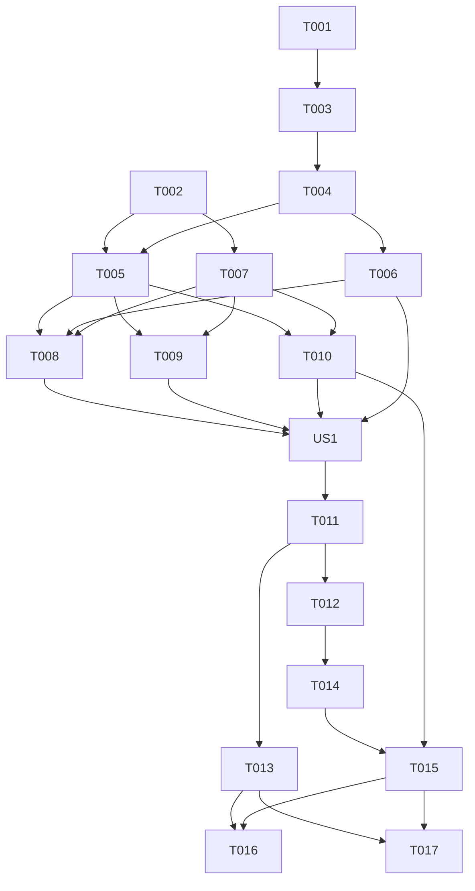

---

description: "Task list for Localization and Dynamic Currency"
---

# Tasks: Localization and Dynamic Currency

**Input**: Design documents from `/specs/011-localization-dynamic-currency/`

**Prerequisites**: plan.md, spec.md, research.md, data-model.md, quickstart.md

**Tests**: No automated test tasks are included because the project constitution prohibits unit, integration, and end-to-end tests. Validation uses formatting, static analysis, and manual runtime review.

**Organization**: Tasks follow the three prioritized user stories. User Story 2 uses the locale from User Story 1; User Story 3 uses its currency rules and shared formatter.

## Phase 1: Setup

**Purpose**: Add the small preference dependency and localization resource setup.

- [X] T001 [P] Add `shared_preferences` to `pubspec.yaml` and resolve the compatible package version in `pubspec.lock`.
- [X] T002 [P] Configure localization generation in `l10n.yaml` and create the English and Vietnamese resource catalogs in `lib/l10n/app_en.arb` and `lib/l10n/app_vi.arb`.

---

## Phase 2: Foundational (Blocking Prerequisites)

**Purpose**: Provide a persistent and reactive selected-locale state for all user stories.

- [X] T003 Implement locale preference read/write and validation for `en_US` and `vi_VN` using `SharedPreferencesAsync` in `lib/services/locale_preference_store.dart` (depends on T001).
- [X] T004 Implement locale state, restore/select events, and startup fallback behavior in `lib/blocs/locale/locale_bloc.dart`, `lib/blocs/locale/locale_event.dart`, and `lib/blocs/locale/locale_state.dart` (depends on T003).

**Checkpoint**: The app can restore a saved supported locale, use a supported device locale when no preference exists, and fall back to English (US).

---

## Phase 3: User Story 1 - Use the App in a Preferred Language (Priority: P1) 🎯 MVP

**Goal**: Let users select English (US) or Vietnamese, apply it across the app immediately, and retain the choice across restarts.

**Independent Test**: Select each language in Profile; confirm navigation, screen copy, static messages, transaction types, and all category names change without restarting; restart the app and confirm the selection is restored; with no saved choice and an unsupported device language, confirm English (US) is used.

### Implementation for User Story 1

- [X] T005 [P] [US1] Provide the locale BLoC to the root app and configure reactive locale selection, supported locales, and localization delegates in `lib/main.dart` (depends on T002 and T004).
- [X] T006 [P] [US1] Add a language selector to the Profile destination and dispatch locale selection events from `lib/screens/shell/widgets/locale_controls.dart` and `lib/screens/shell/widgets/destination_view.dart` (depends on T004).
- [X] T007 [P] [US1] Add English (US) and Vietnamese translations for all static interface strings, transaction types, category labels, accessibility labels, hints, validation messages, and empty states in `lib/l10n/app_en.arb` and `lib/l10n/app_vi.arb` (depends on T002).
- [X] T008 [P] [US1] Replace hard-coded navigation, Profile, theme-control, and placeholder destination copy with generated translations in `lib/screens/shell/app_destination.dart`, `lib/screens/shell/widgets/destination_view.dart`, `lib/screens/shell/widgets/navigation_item.dart`, and `lib/screens/shell/widgets/theme_controls.dart` (depends on T005, T006, and T007).
- [X] T009 [P] [US1] Replace hard-coded Dashboard and transaction-ledger copy, empty states, accessibility labels, and month/date labels with generated translations in `lib/screens/dashboard/dashboard_screen.dart`, `lib/screens/dashboard/widgets/wallet_balance_card.dart`, `lib/screens/transactions/transactions_screen.dart`, `lib/screens/transactions/widgets/ledger_month_selector.dart`, and `lib/screens/transactions/widgets/transaction_date_group_view.dart` (depends on T005 and T007).
- [X] T010 [P] [US1] Replace hard-coded transaction-entry, category-selection, and transaction-type copy with generated translations, and map all 24 stable category IDs to localized labels in `lib/screens/add_transaction/add_transaction_screen.dart`, `lib/screens/category_selection/category_selection_screen.dart`, `lib/shared/widgets/type_segmented_button.dart`, and `lib/l10n/category_localizations.dart` (depends on T005 and T007).

**Checkpoint**: Users can choose and retain a language, and all current visible static app text and predefined category names switch immediately.

---

## Phase 4: User Story 2 - Read Amounts in the Locale's Currency Format (Priority: P2)

**Goal**: Display every existing monetary amount using the active locale's USD or VND rules while preserving stored numeric values.

**Independent Test**: Switch between English (US) and Vietnamese and inspect Dashboard balance, transaction ledger balance, daily totals, and transaction rows. Confirm symbol placement, grouping, and precision match the selected locale and that changing locale does not convert stored numeric amounts.

### Implementation for User Story 2

- [X] T011 [US2] Implement one shared formatter using explicit `en_US`/USD/`$`/2-digit and `vi_VN`/VND/`₫`/0-digit rules in `lib/shared/formatters/currency_formatter.dart`, then retire the locale-insensitive `formatMinorCurrency` implementation in `lib/models/ledger.dart`.
- [X] T012 [P] [US2] Remove hard-coded USD currency metadata from `WalletSummary` and its sample construction, and format Dashboard and ledger balance amounts from the active locale in `lib/models/transaction.dart`, `lib/screens/shell/app_shell.dart`, `lib/screens/dashboard/dashboard_screen.dart`, `lib/screens/dashboard/widgets/wallet_balance_card.dart`, and `lib/screens/transactions/transactions_screen.dart` (depends on T011).
- [X] T013 [P] [US2] Format transaction row and daily total amounts through the shared formatter using the active locale in `lib/screens/dashboard/widgets/recent_transaction_row.dart`, `lib/screens/transactions/widgets/ledger_transaction_row.dart`, `lib/screens/transactions/widgets/transaction_date_group_view.dart`, and `lib/shared/widgets/transaction_list_item.dart` (depends on T011).

**Checkpoint**: Dashboard and transaction ledger amounts react to locale changes; stored `amountMinorUnits` values remain unchanged.

---

## Phase 5: User Story 3 - Enter Amounts Using Familiar Conventions (Priority: P3)

**Goal**: Accept valid amount text under each currency's precision rules and preserve unsaved form values while the locale changes.

**Independent Test**: In Vietnamese, save a whole-number amount and confirm decimal input is rejected. In English (US), save an amount with up to two fractional digits and confirm malformed or over-precision input is rejected. Change locale with unsaved text in the form and confirm the raw text remains.

### Implementation for User Story 3

- [X] T014 [US3] Make amount parsing locale-aware in `lib/models/transaction.dart`: accept whole-number VND input and USD input with up to two fractional digits, and convert valid amounts into the existing integer minor-unit representation without locale-change conversion (depends on T012).
- [X] T015 [US3] Update the transaction amount field's currency hint, locale-sensitive validation, and save behavior while preserving the existing controller text during locale changes in `lib/screens/add_transaction/add_transaction_screen.dart` (depends on T010 and T014).

**Checkpoint**: Valid input saves in each locale, invalid precision is rejected, and changing language retains the unsaved draft.

---

## Phase 6: Polish & Cross-Cutting Validation

**Purpose**: Generate resources and validate static and user-visible behavior without automated tests.

- [X] T016 [P] Run `flutter gen-l10n`, `dart format --output=none --set-exit-if-changed lib`, and `flutter analyze` for localization and formatting changes under `l10n.yaml`, `lib/`, `pubspec.yaml`, and `pubspec.lock`.
- [ ] T017 [P] Follow the manual locale, currency, persistence, input, and layout review in `specs/011-localization-dynamic-currency/quickstart.md`.

---

## Dependencies & Execution Order

### Phase Dependencies

- **Setup (Phase 1)**: T001 and T002 can start immediately and can run in parallel.
- **Foundational (Phase 2)**: T003 depends on T001; T004 depends on T003. Both block user story work requiring locale state.
- **User Story 1 (Phase 3)**: Starts after T002 and T004. Its root locale hookup, Profile selector, and translation catalog can proceed in parallel; string migrations follow those prerequisites.
- **User Story 2 (Phase 4)**: Follows US1 so reactive locale state is available. T011 establishes the shared formatter; T012 and T013 can then run in parallel.
- **User Story 3 (Phase 5)**: Follows locale and currency setup. T014 depends on T012's amount-model cleanup; T015 depends on T014 and the localized transaction form from T010.
- **Polish (Phase 6)**: T016 and T017 require all implementation tasks and can run in parallel.

### User Story Dependencies

- **User Story 1 (P1)**: Depends on setup and foundational locale state; no other story dependency.
- **User Story 2 (P2)**: Depends on US1's locale state and root app localization.
- **User Story 3 (P3)**: Depends on US1 locale state and US2's amount representation/formatter decisions; it does not require budget data or editing flows not currently present.

### Dependency Graph


## Parallel Opportunities

- **Setup**: T001 and T002 affect separate configuration and resource files.
- **User Story 1**: After prerequisites, T005, T006, and T007 touch separate files; after those complete, T008, T009, and T010 update separate screen groups.
- **User Story 2**: T012 and T013 update separate monetary display groups after T011.
- **Polish**: T016 static validation and T017 manual runtime review are independent once implementation is complete.

## Parallel Examples

### User Story 1

```text
Task: Connect locale state and delegates in lib/main.dart
Task: Add language selection in lib/screens/shell/widgets/locale_controls.dart
Task: Populate lib/l10n/app_en.arb and lib/l10n/app_vi.arb
```

### User Story 2

```text
Task: Update Dashboard and balance currency display in lib/screens/dashboard/dashboard_screen.dart
Task: Update ledger row and daily total currency display in lib/screens/transactions/widgets/transaction_date_group_view.dart
```

## Implementation Strategy

### MVP First (User Story 1 Only)

1. Complete Setup and Foundational phases.
2. Complete US1 to let users choose and persist a language and see all static app text translated immediately.
3. Validate US1 independently by changing language and restarting the app.

### Incremental Delivery

1. Deliver US1 as the language-selection MVP.
2. Add US2 locale-based monetary display without changing stored values.
3. Add US3 currency-specific input precision and draft preservation.
4. Complete formatting, localization generation, static analysis, and the manual review in `quickstart.md`.

## Notes

- Every task follows the required checkbox, sequential ID, optional parallel marker, story label where applicable, and explicit file path format.
- `[P]` marks tasks that edit separate files and do not depend on unfinished work.
- The current Budgets destination is placeholder content; translate its static copy but do not create budget records or flows.
- No automated test files or tasks may be added under the project constitution.